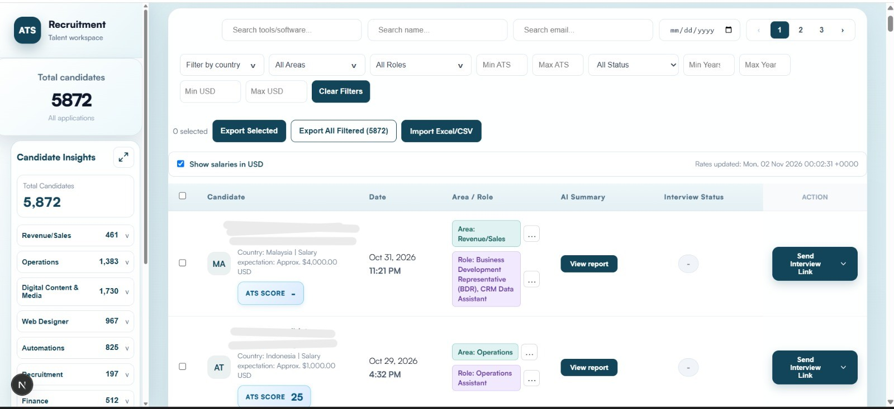
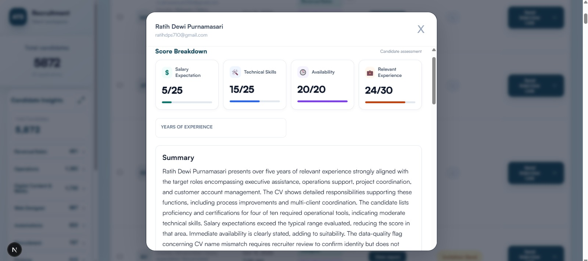
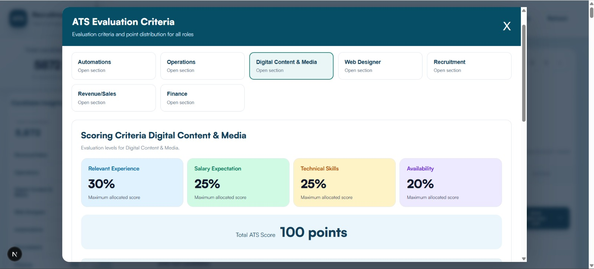

# AI-Powered-ATS-Recruiter-Dashboard

---

## 📺 System Walkthrough

🎥 Watch the complete technical demonstration and ATS workflow:

https://www.loom.com/share/8d24363b77614881b729cd9e8522ed44

---

## 🚀 Project Overview

This project is an **AI-Powered Applicant Tracking System (ATS) and Recruiter Dashboard** that automates candidate evaluation from the moment an applicant submits an application through a company's website.

Using **n8n AI workflows**, the system processes candidate applications and resumes, evaluates applicants against predefined ATS scoring criteria, and generates detailed candidate assessments.

The complete evaluation is then stored and displayed in a centralized **Recruiter Dashboard**, allowing recruiters to review candidate insights without manually analyzing every submitted resume.

---

# 📝 The System Workflow

## 1️⃣ Candidate Application & Resume Submission

The process starts when a candidate visits the company's recruitment website and submits an application through the application form.

Candidates provide their information and upload their resumes/CVs.

The application information can include:

- Full Name
- Email Address
- Position Applied For
- Recruitment Area
- Resume / CV
- Other application details

---

## 2️⃣ Automated Resume Ingestion

The n8n workflow receives candidate applications and manages the initial processing.

The workflow:

- Receives application data through webhooks.
- Retrieves submitted resume information.
- Validates incoming application data.
- Checks existing candidate records.
- Organizes candidate information.
- Routes applications into the resume-processing workflow.

This eliminates the need for recruiters to manually collect and forward applications for initial evaluation.

---

## 3️⃣ CV Parsing & Data Extraction

The submitted resumes are processed using **LlamaParse** to extract structured information from candidate CVs.

The workflow extracts and processes relevant candidate details, including:

- Personal information
- Employment history
- Years of experience
- Technical skills
- Education and qualifications
- Certifications
- Salary expectations, where provided
- Availability, where provided

---

## 4️⃣ AI-Powered ATS Evaluation

The processed resume and relevant job description are sent to the **ATS Brain** for intelligent candidate assessment.

The AI analyzes the candidate's profile against the requirements of the applied position.

The evaluation considers:

- Relevant work experience
- Technical skills
- Salary expectations
- Availability
- Job-specific requirements
- Candidate qualifications

The objective is to determine how closely the candidate matches the requirements of the applied role.

---

## 5️⃣ Custom ATS Scoring System

The system uses a structured **100-point ATS scoring framework** to evaluate candidates.

The scoring distribution is:

| Evaluation Criteria | Weight |
| :--- | :---: |
| **Relevant Experience** | **30%** |
| **Salary Expectation** | **25%** |
| **Technical Skills** | **25%** |
| **Availability** | **20%** |
| **Total ATS Score** | **100%** |

Each category has defined evaluation levels and scoring rules.

This allows candidates to be assessed consistently based on the requirements of their respective positions.

---

## 6️⃣ Candidate Insights & AI-Generated Assessment

After evaluating the resume, the ATS Brain generates a structured assessment containing the candidate's complete evaluation details.

The generated information includes:

- **Overall ATS Score:** Candidate's total score out of 100.
- **Skills Match Score:** Evaluation of relevant technical skills.
- **Experience Match Score:** Assessment of relevant work experience.
- **Salary Expectation:** Extracted and evaluated salary information.
- **Availability:** Candidate's stated availability.
- **Years of Experience:** Relevant experience identified from the resume.
- **Candidate Summary:** AI-generated overview of the candidate's profile.
- **Strengths:** Relevant skills, experience, and qualifications.
- **Gaps:** Missing skills, experience, or requirements.
- **Recommendation:** AI-generated candidate suitability assessment.

This provides recruiters with a detailed candidate assessment rather than requiring them to interpret every resume manually.

---

## 7️⃣ Automated Candidate Record Creation

Once the AI evaluation is completed, the system prepares the complete candidate record.

The processed candidate information and assessment results are stored in the backend database.

The record contains the candidate's application details together with their ATS evaluation.

This ensures that the recruiter dashboard can display the candidate's information and assessment in one place.

---

## 8️⃣ ATS Recruiter Dashboard

The recruiter dashboard is the central workspace for managing and reviewing evaluated candidates.

It displays candidate applications together with their AI-generated assessments and ATS scores.

Key dashboard information includes:

- Total Candidates
- Candidate Name
- Application Date
- Country
- Position Applied For
- Recruitment Area
- AI-Generated Summary
- ATS Score
- Interview Status
- Candidate Evaluation Report

  

---

## 9️⃣ Detailed Candidate Assessment & Score Breakdown

Recruiters can open an individual candidate's evaluation report to review the complete ATS assessment. The assessment also displays the candidate's years of experience, AI-generated summary, strengths, and gaps.

  

This allows recruiters to understand exactly how a candidate performed in each evaluation category.

---

## 🔟 Role-Based ATS Evaluation Criteria

The system supports dedicated evaluation criteria across different recruitment areas.

Available areas include:

- Automations
- Operations
- Digital Content & Media
- Web Designer
- Recruitment
- Revenue/Sales
- Finance

Each recruitment area has its own role-specific evaluation requirements and scoring guidelines.

The framework evaluates candidates using:

- Relevant Experience — 30%
- Salary Expectation — 25%
- Technical Skills — 25%
- Availability — 20%

  

This ensures that candidates are assessed according to the requirements of their respective job categories rather than relying on one generic evaluation standard.

---

## 📊 Candidate Insights & Recruitment Analytics

The dashboard provides an overview of candidate applications and their distribution across recruitment areas.

Recruiters can review:

- Total candidate applications.
- Candidate distribution by recruitment area.
- Applicant counts across different departments.
- Candidate ATS scores.
- Interview statuses.
- Candidate evaluation information.

These insights provide better visibility into the recruitment pipeline and help recruiters organize candidate screening activities.

---

## 📥 Candidate Import & Export

The system also includes candidate data management functionality.

Recruiters can:

- Import candidate records through Excel/CSV files.
- Export selected candidates.
- Export all filtered candidate records.
- Manage large candidate datasets through bulk operations.

This makes it easier to manage recruitment data and work with large applicant databases.

---

## 📨 Interview Management

After reviewing candidate evaluations, recruiters can initiate the next stage of the recruitment process.

The dashboard provides a **Send Interview Link** action directly within the candidate records.

This connects automated resume screening with the interview workflow.

The complete recruitment journey becomes:

**Application → AI Evaluation → ATS Scoring → Recruiter Review → Shortlisting → Interview**

---

# ⚙️ Backend Architecture: n8n Automation Workflow

The backend automation is organized into four major phases:

| Phase | Workflow | Purpose |
| :--- | :--- | :--- |
| **Phase 1** | Resume Ingestion | Receives and validates candidate applications and resumes. |
| **Phase 2** | n8n Workflow Engine | Initializes candidate records and manages workflow processing. |
| **Phase 3** | Data Processing | Parses CVs, extracts candidate information, and validates extracted data. |
| **Phase 4** | Send to ATS Brain | Sends resumes and job descriptions for AI evaluation and processes the resulting assessment. |

---
# 🚀 Business Impact

The system transforms a traditionally manual resume-screening process into an automated AI-powered candidate evaluation workflow.

### Before Automation

**Candidate Applications → Manually Download CVs → Open Individual Resumes → Review Experience → Check Skills → Evaluate Salary & Availability → Compare Candidates → Prepare Shortlists**

### After Automation

**Candidate Applications → Automated Resume Processing → AI Candidate Evaluation → ATS Score Generation → Candidate Insights → Centralized Recruiter Dashboard → Candidate Shortlisting**

---

# 🚀 Key Result

The final system connects the complete recruitment process:

**Company Website → Candidate Application → n8n Automation → Resume Parsing → AI-Powered ATS Evaluation → 100-Point ATS Scoring → Candidate Insights → Database → Recruiter Dashboard → Shortlisting & Interview Management**

This creates a centralized and scalable **AI-Powered Applicant Tracking and Recruitment Automation System**, helping recruiters process applications faster and make more structured hiring decisions.

---

## ✍️ Author

**Muneeb Ali Khan**

**AI Automation & GTM Engineer**

- **LinkedIn:** [Muneeb Ali Khan](https://www.linkedin.com/in/muneeb-ali-khan-2a1675365)
